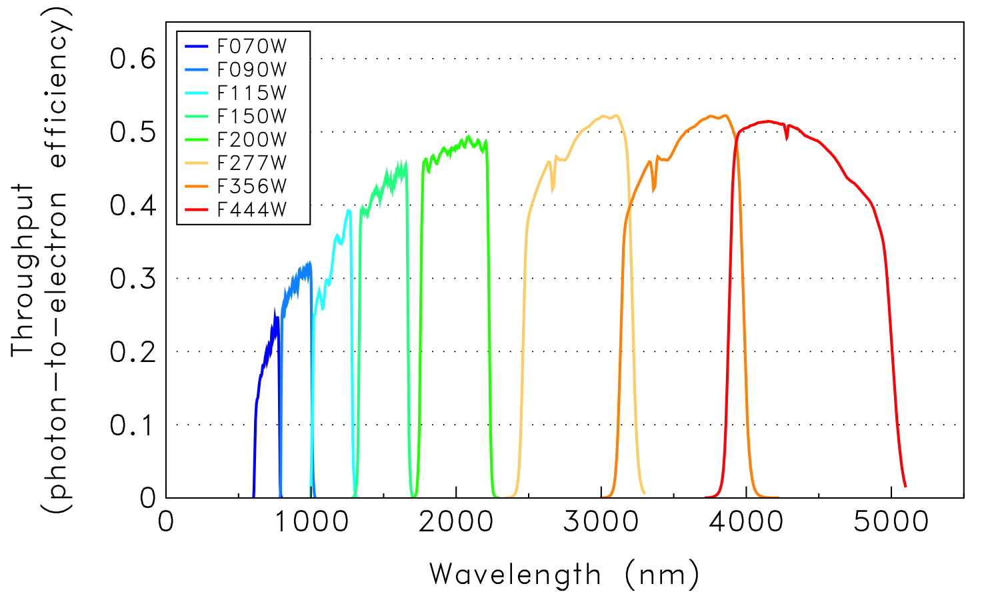
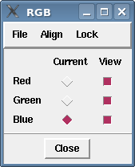
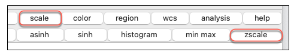

# AstroLab C1: Composing RGB Images from Telescope Data

Turn three images taken at different wavelengths into one colour picture.

| Time | Software | Activities | Submit |
| :-: | :-: | :-: | :-: |
| About 2 hours | SAOImageDS9 | RGB creation | The C1 proforma on Canvas |

**Start here:** download the [AstroLab C1 proforma](https://github.com/mjcowley/astrolabs/raw/main/C1/AstroLabC1_Proforma.docx) and fill it in as you go. When you've finished both parts, submit it as a Word document or PDF on the *Assignments* page on Canvas by the due date.

**Contents:** [Overview](#overview) · [How to complete this AstroLab](#how-to-complete-this-astrolab) · [Software and data](#software-and-data) · [Part 1: The Carina Nebula](#part-1-the-carina-nebula) · [Part 2: A mystery in infrared](#part-2-a-mystery-in-infrared) · [Troubleshooting](#troubleshooting) · [Optional extension](#optional-extension)

## Overview

In this AstroLab you'll compose Red-Green-Blue (**RGB**) composite images from astronomical data. In Part 1, you'll build an image of part of the Carina [Nebula](http://astro.vaporia.com/start/nebula.html) using data taken through three [bands](http://astro.vaporia.com/start/spectralband.html) (filters) on the James Webb Space Telescope's ([JWST](https://www.jwst.nasa.gov/index.html)) Near-Infrared Camera ([NIRCam](https://www.jwst.nasa.gov/content/observatory/instruments/nircam.html)). In Part 2, you'll research an object called NGC 7293, build your own RGB image of it from three very different infrared wavelengths, and work out what the colours are telling you.

Astronomical [camera sensors](http://astro.vaporia.com/start/ccd.html) record how much light lands on each pixel, but not its colour. A colour sensor puts a grid of red, green and blue filters over its pixels, so each pixel throws away about two-thirds of the light, which sacrifices too much [sensitivity](http://astro.vaporia.com/start/sensitivityfunction.html). Astronomers also want to choose their own bands, including infrared bands our eyes can't see. Instead, we take separate images through different filters and combine them into an RGB image.

The Cosmic Cliffs are a gaseous cavity within [NGC 3324](https://en.wikipedia.org/wiki/NGC_3324), part of the Carina Nebula. The tallest "peaks" of gas and dust are about 7 light-years high (about 70 trillion km). The cavity has been carved away by intense ultraviolet radiation and stellar winds from extremely massive, hot, young stars, and the pillars that tower above the glowing wall of gas resist this radiation. The blue "steam" that appears to rise from the celestial "mountains" is hot, ionised gas and dust streaming away from the nebula due to the relentless radiation.

JWST lets us observe emerging stellar nurseries and individual stars that are completely hidden in visible-light pictures. Because JWST is sensitive to infrared light, we can peer through cosmic dust to see the once-hidden process of star formation in action.

**By the end of this AstroLab you'll be able to:**

* open and display FITS images in SAOImageDS9
* adjust an image's contrast so faint detail shows up
* read a filter throughput plot
* combine three images into an RGB composite and explain your colour choices
* research an astronomical object, and explain what different wavebands reveal about it

## How to complete this AstroLab

You can complete C1 on campus in your scheduled session, or remotely in your own time. The steps are the same either way, and everyone submits the same proforma.

**On campus**

* Come to your scheduled AstroLab session. SAOImageDS9 is already installed on the lab computers.
* The teaching team will run a live demonstration and help you as you go.

**Remote**

* Watch the walkthrough recording on Echo360 (on Canvas). It covers everything from the live session.
* Install SAOImageDS9 on your own computer, or use QUT's Virtual Desktop Infrastructure (see [Software and data](#software-and-data)).
* Work through [Before you start](#before-you-start) first, so setup problems don't hold you up.
* If you get stuck, contact the teaching team.

## Software and data

This AstroLab uses SAOImageDS9, a free and open-source application for exploring astronomical images. It's pre-installed on QUT's lab computers. To use your own computer, download the version for your system from the [SAOImageDS9 download page](https://sites.google.com/cfa.harvard.edu/saoimageds9/download), which also has installation help for each system (including macOS security warnings).

If you'd rather not install anything, you can use SAOImageDS9 through [QUT's Virtual Desktop Infrastructure](https://gist.github.com/mjcowley/fe60fae650deedb8ea3b4d21cf274365). For help with the software, see the [SAOImageDS9 interface guide](https://ds9.si.edu/doc/user/gui/index.html) and the [SAOImageDS9 Reference Manual](https://ds9.si.edu/doc/ref/).

Click any file name below to download it.

### Part 1 data

For Part 1 you'll need the three JWST images below. They're cut out from the full NIRCam mosaics in the Space Telescope Science Institute's ([STScI](https://www.stsci.edu/home)) Mikulski Archive for Space Telescopes ([MAST](https://archive.stsci.edu/)), keeping JWST's full resolution. They're compressed FITS files (`.fits.fz`), which SAOImageDS9 opens just like ordinary FITS files.

| File | Filter | Size |
| --- | --- | --- |
| [carina_jwst_f090w.fits.fz](https://github.com/mjcowley/astrolabs/raw/main/data/C1/carina_jwst_f090w.fits.fz) | F090W | 36 MB |
| [carina_jwst_f200w.fits.fz](https://github.com/mjcowley/astrolabs/raw/main/data/C1/carina_jwst_f200w.fits.fz) | F200W | 37 MB |
| [carina_jwst_f444w.fits.fz](https://github.com/mjcowley/astrolabs/raw/main/data/C1/carina_jwst_f444w.fits.fz) | F444W | 10 MB |

### Part 2 data

For Part 2 you'll need these three images of NGC 7293. They're small, so this is quick. Like the Part 1 images, they're compressed FITS files that SAOImageDS9 opens directly.

| File | Size |
| --- | --- |
| [ngc7293_spitzer_irac_3.6micron.fits.fz](https://github.com/mjcowley/astrolabs/raw/main/data/C1/ngc7293_spitzer_irac_3.6micron.fits.fz) | 5.6 MB |
| [ngc7293_spitzer_mips_24micron.fits.fz](https://github.com/mjcowley/astrolabs/raw/main/data/C1/ngc7293_spitzer_mips_24micron.fits.fz) | 0.4 MB |
| [ngc7293_herschel_spire_250micron.fits.fz](https://github.com/mjcowley/astrolabs/raw/main/data/C1/ngc7293_herschel_spire_250micron.fits.fz) | 0.1 MB |

They're cut out from the Spitzer Enhanced Imaging Products and the Herschel High Level Images in NASA's Infrared Science Archive ([IRSA](https://irsa.ipac.caltech.edu/)), so all three cover the same patch of sky. The corners of the Herschel image are blank because the telescope didn't map that far out.

### Before you start

If you're working remotely, do these first:

1. Download the three Part 1 JWST files and the three Part 2 files.
2. Install SAOImageDS9 and open one of the files (the 10 MB F444W image is quickest) to check it works.
4. Download the [AstroLab C1 proforma](https://github.com/mjcowley/astrolabs/raw/main/C1/AstroLabC1_Proforma.docx) so you can fill it in as you go.

## Part 1: The Carina Nebula

1. **Watch the demonstration.** Watch the live demo if you're on campus, or the walkthrough recording on Echo360 (on Canvas) if you're remote.

2. **Read the filter plot.** The plot below shows the fraction of incoming photons recorded at each wavelength, combining the filter, the telescope optics and the detector's [quantum efficiency](http://astro.vaporia.com/start/qe.html). Note roughly where F090W, F200W and F444W sit, as you'll use this to decide which filter goes in which colour channel.

   

   *NIRCam filter throughput (the fraction of photons recorded at each wavelength)*

3. **Open an RGB frame.** Open SAOImageDS9 and select ***Frame***, then ***New Frame RGB*** from the top menu bar. A small RGB window will open, as shown below. **Keep this window open for the rest of the activity.**

   

4. **Lock and align the channels.** Click the RGB window, then from its menu bar select ***Lock*** and tick both ***Scale*** and ***Colorbar***. If you can't see the ***Lock*** menu, click the small RGB window first. While you're there, check that ***Align*** is set to ***WCS***. F444W has bigger pixels than the other two filters, so SAOImageDS9 uses sky coordinates (the WCS) to line the images up.

5. **Load the red channel.** Decide which filter belongs in each of the R, G and B channels ([Hint](https://jwst-docs.stsci.edu/jwst-near-infrared-camera/nircam-instrumentation/nircam-filters)). If your image turns out odd, you've likely assigned the wrong filters. To load the red channel, select ***Red*** under the ***Current*** column in the RGB window. Then, in the main SAOImageDS9 window, select ***File***, ***Open*** and choose the relevant file.

6. **Fix the contrast.** Your image will probably look completely black, as if JWST were broken! Never fear, the problem is contrast. Click the ***Scale*** button in the main SAOImageDS9 window, then ***Zscale***, as shown below. Use your mouse wheel to zoom in and out. You should now see a monochrome image of the Carina Nebula.

   

7. **Add the green and blue channels.** Repeat steps 5 and 6 to load the green and blue channels. You should now have your final RGB image of the Carina Nebula. Beautiful, isn't it?

8. **Capture your image.** Take a screenshot of the SAOImageDS9 window with the small RGB window visible, and paste it into Part 1 of your proforma. To keep a copy of the image itself, use ***File***, ***Save Image***, ***PNG***, which saves the current view. Then move on to Part 2.

## Part 2: A mystery in infrared

Now it's your turn to be the astronomer. You have three images of an object called **NGC 7293**, taken at three very different infrared wavelengths by two space telescopes. Find out what it is, build your own RGB image, and work out what the colours are telling you.

1. **Research your object.** Find out what NGC 7293 is. What kind of object is it, roughly how far away is it, how did it form, and what's at its centre? Good places to start are [SIMBAD](https://simbad.cds.unistra.fr/simbad/), NASA's and ESA's websites, and Wikipedia (then follow its references). Note your sources, as you'll need them in your proforma.

2. **Work out what you have.** The file names tell you the telescope, instrument and wavelength of each image. For each one, find out what that wavelength mainly shows in an object like this, such as starlight, warm dust or cold dust. Record this in the table in your proforma.

3. **Decide your colours.** Use the same rule as Part 1: shortest wavelength in blue, middle in green, longest in red.

4. **Build your image.** Open a new RGB frame (***Frame***, ***New Frame RGB***), lock ***Scale*** and ***Colorbar***, check ***Align*** is set to ***WCS***, and load each channel as in Part 1. These images come from different telescopes with very different resolutions and pixel sizes, so aligning by WCS really matters here.

5. **Adjust the contrast.** Zscale may not suit every image. Try the other options under ***Scale***, such as ***log***, ***sqrt*** or ***99.5***, until each channel shows structure. If one channel overwhelms the others, untick ***Lock***, ***Scale*** in the RGB window, select that channel under ***Current***, and adjust it on its own.

6. **Capture your image.** Take a screenshot of the SAOImageDS9 window with the small RGB window visible, and paste it into Part 2 of your proforma.

7. **Read the colours.** Look closely at where each colour appears. Is the same structure visible in all three channels, or does each wavelength show something different? What's in the very centre, and what's further out? Use what you found in steps 1 and 2 to explain what each colour is showing you, and what that says about the temperature of the material and the object's history.

8. **Compare with visible light.** Find a visible-light image of NGC 7293 (for example, from the Hubble Space Telescope). In your proforma, compare it with your image and explain why they look different, and what each one reveals that the other can't. Notice the sharpness of each of your three channels, too: why might some look blurrier than others?

**Finished?** Submit your completed proforma on the *Assignments* page on Canvas.

## Troubleshooting

* If your image is all black, set ***Scale*** to ***Zscale*** (Part 1, step 6).
* If you can't see the ***Lock*** menu, click the small RGB window first so its menu bar is active.
* If macOS won't open SAOImageDS9, follow the installation help on the [SAOImageDS9 download page](https://sites.google.com/cfa.harvard.edu/saoimageds9/download).
* If the three channels don't line up, check that ***Align*** is set to ***WCS*** in the RGB window.
* If the colours look odd, check which file you've loaded into each channel.
* If one channel looks blank or swamps the others in Part 2, try a different scale, or untick ***Lock***, ***Scale*** and adjust that channel on its own (Part 2, step 5).
* If a file won't open, check it downloaded completely. If you right-clicked the link and chose *Save link as*, try clicking it instead.

## Optional extension

The Part 1 images are cut out from much bigger mosaics. Find the full observation yourself: the "jw02731" in the original file names means JWST program 2731. Search for it in the [MAST Portal](https://mast.stsci.edu/) and see which other filters were used. Be warned that each full mosaic is about 5 GB!

## Credits

* Part 1: JWST NIRCam images of NGC 3324 from program 2731 (the JWST Early Release Observations), via MAST.
* Part 2: Spitzer IRAC and MIPS images of NGC 7293 from the Spitzer Enhanced Imaging Products, and a Herschel SPIRE image from the Herschel High Level Images, via IRSA. Herschel is an ESA space observatory with science instruments provided by European-led Principal Investigator consortia and with important participation from NASA.
* All the images were cut out with [`tools/make_c1_data.py`](../tools/make_c1_data.py).
