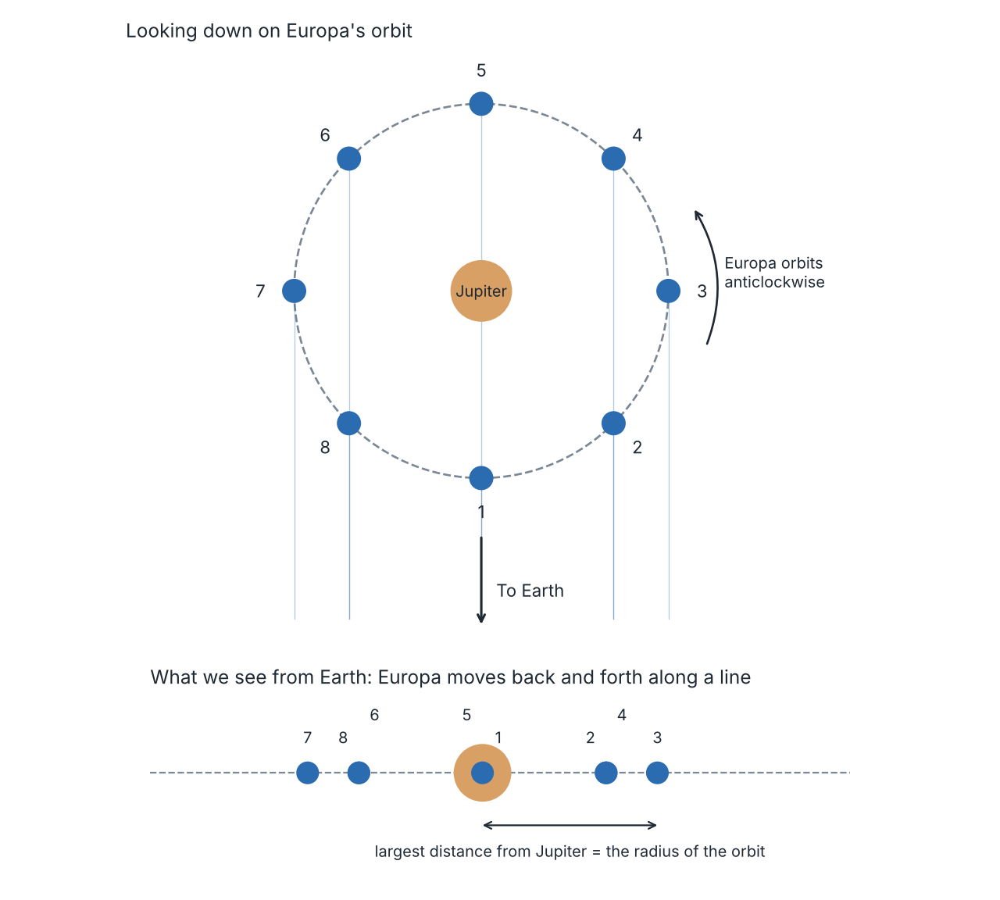

# AstroLab C1: The Celestial Sphere and Jupiter's Moons

Find your way around the sky, then weigh Jupiter by timing one of its moons.

> **Draft for testing.** This AstroLab is being tested for 2027. If something doesn't match what you see in Stellarium, let the teaching team know.

| Time | Software | Activities | Submit |
| :-: | :-: | :-: | :-: |
| About 2 hours | Stellarium | Sky coordinates, precession, Kepler's third law | The C1 proforma on Canvas |

**Start here:** download the [AstroLab C1 proforma](https://github.com/mjcowley/astrolabs/raw/main/C1/AstroLabC1_Proforma.docx) and fill it in as you go. When you've finished both parts, submit it as a Word document or PDF on the *Assignments* page on Canvas by the due date.

**Contents:** [Overview](#overview) · [How to complete this AstroLab](#how-to-complete-this-astrolab) · [Software](#software) · [Set up Stellarium](#set-up-stellarium) · [Part 1: Finding your way around the sky](#part-1-finding-your-way-around-the-sky) · [Part 2: Weighing Jupiter](#part-2-weighing-jupiter) · [Troubleshooting](#troubleshooting) · [Optional extension](#optional-extension)

## Overview

Look up on a clear night and the sky seems like a giant dome, with the stars fixed to its inside. Astronomers still use that idea, the *celestial sphere*, to say where things are. There's more than one way to give a position on it, though, and choosing the right one matters.

The simplest way is to say how high an object is above the horizon (its *altitude*) and which direction it's in (its *azimuth*, measured from north through east). That's easy to use, but it only works for one place at one moment. As Earth turns, every star's altitude and azimuth change, and someone in another city sees different numbers at the same instant. Catalogues use the *equatorial system* instead. It projects Earth's equator and poles onto the sky and gives each object a *right ascension* (RA, like longitude) and a *declination* (Dec, like latitude). Those stay the same wherever and whenever you look, almost. Earth's axis slowly wobbles like a spinning top, once every 26,000 years, which drags the whole grid across the sky. This is *precession*, and it's why every catalogue says which date, or *epoch*, its coordinates are for. Most use J2000 (midday on 1 January 2000).

Once you know where things are, you can measure how they move. In January 1610, Galileo pointed his new telescope at Jupiter and saw four small "stars" beside it that shifted from night to night. They were moons, now called the Galilean moons (Io, Europa, Ganymede and Callisto), and they were the first objects ever seen orbiting something other than Earth. Their orbits follow Kepler's third law, which links an orbit's size to the time it takes. Newton later showed that the law also depends on the mass of the body at the centre, so timing a moon is a way of weighing its planet.

In this AstroLab you'll use Stellarium, a free planetarium program, to explore both ideas. In Part 1, you'll see why altitude and azimuth aren't used in catalogues, which stars never set from Brisbane, and how precession moves the poles. In Part 2, you'll track Europa for four days, plot its orbit, and use Kepler's third law to work out Jupiter's mass.

**By the end of this AstroLab you'll be able to:**

* explain why a star's altitude and azimuth change with time and place, while its RA and Dec don't
* explain what makes a star circumpolar, and how that depends on where you are
* describe precession, and explain why catalogues give coordinates for an epoch such as J2000
* measure a moon's orbital period and orbit size from its positions over time
* use Kepler's third law to work out a mass from an orbit

## How to complete this AstroLab

You can complete C1 on campus in your scheduled session, or remotely in your own time. The steps are the same either way, and everyone submits the same proforma.

**On campus**

* Come to your scheduled AstroLab session. Stellarium is already installed on the lab computers.
* The teaching team will run a background information session and help you as you go.

**Remote**

* Watch the recording of the background information session on Echo360 (on Canvas). It covers everything from the live session.
* Install Stellarium on your own computer (see [Software](#software)).
* Work through [Before you start](#before-you-start) first, so setup problems don't hold you up.
* If you get stuck, contact the teaching team.

## Software

This AstroLab uses [Stellarium](https://stellarium.org/), a free and open-source planetarium for Windows, macOS and Linux. It shows the sky from anywhere on Earth at any date and time, and works out where the Sun, Moon, planets and moons are. It's pre-installed on QUT's lab computers. To use your own computer, download the version for your system from the Stellarium website, which also has a full user guide. There's a web version of Stellarium too, but it doesn't have the measuring tool you'll need in Part 2, so please use the desktop version.

In Part 2 you'll also use the [Kepler's Third Law Calculator](https://mjcowley.github.io/astro_demos/kepler-calculator/), which runs in your web browser. There are no data files to download for this AstroLab.

### Before you start

If you're working remotely, do these first:

1. Install Stellarium and check it opens.
2. Turn on the ***Angle Measure*** tool, which comes with Stellarium but is switched off at first. Open the ***Configuration*** window (press F2), go to the ***Plugins*** tab, select ***Angle Measure*** from the list, tick ***Load at startup***, then close and reopen Stellarium. A new ***Angle Measure*** button will appear in the toolbar at the bottom of the screen.
3. Download the [AstroLab C1 proforma](https://github.com/mjcowley/astrolabs/raw/main/C1/AstroLabC1_Proforma.docx) so you can fill it in as you go.

## Set up Stellarium

Everyone uses the same place and time, so your measurements can be compared. Move your mouse to the bottom-left corner of the screen to show the toolbars. Most of the windows below can also be opened from the toolbar on the left-hand side.

1. Set your location to Brisbane. Open the ***Location*** window (press F6), type `Brisbane` into the search box, select *Brisbane, Australia* from the list, and close the window.

2. Set the date and time to Monday 1 March 2027, 9:00 pm. Open the ***Date/Time*** window (press F5) and type the year, month, day, hour and minute into the boxes (Stellarium uses the 24-hour clock, so 9 pm is 21:00:00).

3. Stop time so the sky stays put while you work by pressing 7 (or using the time buttons at the right-hand end of the bottom toolbar). The date and time shown in the bottom toolbar should no longer change.

4. Check everything's right by finding Jupiter. Open the ***Search*** window (press F3), type `Jupiter` and press Enter. Jupiter should be selected, about 40° above the horizon in the north-east, and the information at the top left of the screen should show its distance from Earth as about 4.4 AU. If it's somewhere else, your time zone is probably wrong (see [Troubleshooting](#troubleshooting)).

When you select an object, Stellarium lists information about it at the top left of the screen. The lines you need are ***RA/Dec (J2000)***, ***RA/Dec (on date)***, ***Az./Alt.*** (azimuth and altitude) and ***Distance***.

## Part 1: Finding your way around the sky

### Where is a star?

1. Watch the background information session if you're on campus, or the recording on Echo360 (on Canvas) if you're remote.

2. Find Sirius, the brightest star in the night sky, using the ***Search*** window (press F3). Record its altitude and azimuth, and its RA and Dec (J2000), in the table in your proforma.

3. See how these change over the evening by setting the time to 8:00 pm (20:00) and then 10:00 pm (22:00) in the ***Date/Time*** window. Record Sirius's altitude, azimuth, RA and Dec at each time. Set the time back to 9:00 pm when you're done.

### Same moment, different place

4. Move to London without changing the time. Open the ***Location*** window, search for `London` and select *London, United Kingdom*. Stellarium keeps the same moment but now shows London's sky (it's 11 am there). Check that the time in the bottom toolbar still matches 9 pm in Brisbane.

5. Record Sirius's altitude, azimuth, RA and Dec as seen from London. A negative altitude means the star is below the horizon. Then set your location back to Brisbane.

### Stars that never set

6. Turn off the ground and the atmosphere so you can see stars below the horizon and in daylight. Press G to hide the ground and A to hide the atmosphere, or use the ***Ground*** and ***Atmosphere*** buttons in the bottom toolbar. Press E to show the equatorial grid of RA and Dec lines.

7. Look south, towards the Southern Cross (Crux), by dragging the sky with your mouse or pressing the arrow keys. Find the south celestial pole, the point where the RA lines all meet. It's in a fairly empty patch of sky, with no bright star marking it.

8. Speed up time and watch the sky turn. Press L a few times to speed up (J slows down, and 7 stops time again). Over each day, the stars circle the south celestial pole. Stars close to the pole never dip below the horizon. These are *circumpolar* stars.

9. Measure how low two stars of the Southern Cross get. Stop time, select Acrux (the brightest star of the cross, at its foot) and step through the day an hour at a time in the ***Date/Time*** window until you find roughly when it's lowest. Record its lowest altitude. Do the same for Gacrux, the star at the top of the cross. Then set the date and time back to 1 March 2027, 9:00 pm.

10. Check whether Crux ever rises from London. Set your location to London, speed up time for a day or two, and watch whether the Southern Cross ever appears above the horizon line. Record what you find, then set your location back to Brisbane.

### A wobbling sky

11. Compare the two sets of coordinates for Polaris, the North Star. Search for `Polaris`, then record both its ***RA/Dec (J2000)*** and its ***RA/Dec (on date)***. The J2000 values give its position on the grid as it was in 2000, and the "on date" values give its position on the grid as it is on the date Stellarium is showing.

12. Travel back about 5,000 years by typing `-3000` into the year box of the ***Date/Time*** window (keep the month and day the same). Record the *on date* declination of Polaris, and of Thuban, a star in the constellation Draco. The star with a declination closest to +90° is nearest the north celestial pole, and would have been that era's "North Star".

13. Travel forward to the year 14000 and record the *on date* declinations of Polaris and Vega. Notice that the J2000 values haven't changed in all this time (apart from tiny changes as the stars move through space). Set the date back to 1 March 2027 when you're done, then answer the Part 1 questions in your proforma.

## Part 2: Weighing Jupiter

Europa takes a few days to orbit Jupiter. We see its orbit almost exactly edge-on, so instead of watching it go around in a circle, we see it swing from one side of Jupiter to the other and back again. Its largest distance from Jupiter on either side is the radius of its orbit, and the time it takes to swing out and back is its orbital period.

*Seen from Earth, Europa moves back and forth along a line. At positions 1 and 5 it's in front of or behind Jupiter, and at positions 3 and 7 it's at its largest distance from Jupiter.*

### Find Jupiter and its moons

1. Select Jupiter with the ***Search*** window (press F3), and check the time is still 1 March 2027, 9:00 pm, with time stopped. Keep the ground and atmosphere turned off, so you can follow Jupiter even when it's below the horizon or in daylight. Press E to turn off the equatorial grid.

2. Switch to an equatorial view by pressing Ctrl+M (or clicking the ***Switch between equatorial and azimuthal mount*** button in the bottom toolbar). This keeps north at the top and east on the left, so the moons stay on the same line as you step through time.

3. Centre on Jupiter by pressing the space bar, then zoom in with the mouse wheel until Jupiter is a small disc and its four moons are spread out on either side of it, all lying roughly along a line. Click a moon to see its name, then click Jupiter again so it stays selected. Record Jupiter's distance from Earth (the ***Distance*** line, in AU) in your proforma.

### Track Europa

4. Measure Europa's distance from Jupiter. Turn on the ***Angle Measure*** tool with its button in the bottom toolbar, then click on the centre of Jupiter and drag to Europa. The tool shows the angle between them. Record it in arcminutes (′) in your proforma table, with a minus sign if Europa is to the left of Jupiter and no sign if it's to the right. If Europa is hidden in front of or behind Jupiter, record 0.

5. Step forward 6 hours by adding 6 to the hour in the ***Date/Time*** window (when you go past 23:00, Stellarium moves on to the next day). Re-centre on Jupiter if it has drifted, and measure Europa's distance again.

6. Repeat until you have 17 readings, the last one at 9:00 pm on 5 March 2027. That's four days of observations, a little more than one full orbit.

### Read the orbit

7. Plot your measurements by opening the [Kepler's Third Law Calculator](https://mjcowley.github.io/astro_demos/kepler-calculator/) and typing your 17 readings into the table in step 1 of the page (readings every 6 hours). Your points should trace out a smooth wave. Take a screenshot of the plot and paste it into your proforma.

8. Read the period off your plot, which is the time for one full wave, for example from one peak on one side to the next peak on the same side, or from one place where the wave crosses zero going down to the next place it crosses zero going down. Then read off the largest distance, the height of a peak. Record both in your proforma. You can tick ***Show the best-fit wave*** afterwards to check your reading of the plot.

### Weigh Jupiter

9. Work out Jupiter's mass by typing your period, largest distance and Jupiter's distance from Earth into step 2 of the calculator. Step 3 of the page works through Kepler's third law with your numbers, one step at a time:

   * The angle is changed to radians, the unit astronomers use for angles in calculations.
   * The orbit size is the distance to Jupiter times that angle (for a small angle, the distance across is the distance away times the angle in radians).
   * The period is changed from days to years.
   * Kepler's third law, as Newton wrote it, gives the mass at the centre: with the orbit size *a* in AU and the period *P* in years, the mass is *M* = *a*³ / *P*² solar masses.

   Copy the orbit size in AU, the period in years and Jupiter's mass (in solar masses and in Jupiter masses) into your proforma.

10. Compare your mass with Jupiter's true mass (1 Jupiter mass, about 1/1048 of the Sun's mass). Then use the ***Io***, ***Ganymede*** and ***Callisto*** buttons in step 2 of the calculator to fill in the true orbits of the other three moons, and see what mass each one gives. Answer the Part 2 questions and the reflection in your proforma.

**Finished?** Submit your completed proforma on the *Assignments* page on Canvas.

## Troubleshooting

* If Jupiter isn't about 40° up in the north-east at 9 pm on 1 March 2027, Stellarium is probably using your computer's time zone instead of Brisbane's. Open the ***Location*** window and check the time zone is set to *Australia/Brisbane* (or *UTC+10:00*).
* If the sky keeps moving, press 7 to stop time.
* If you can't see stars below the horizon or in daylight, press G and A to turn off the ground and atmosphere.
* If Jupiter's moons aren't labelled, turn on planet labels in the ***Sky and viewing options*** window (press F4), or click a moon to see its name.
* If there's no ***Angle Measure*** button, check it's ticked to ***Load at startup*** in the ***Plugins*** tab of the ***Configuration*** window, then restart Stellarium.
* If the moons don't stay on a line as you step through time, press Ctrl+M to switch to the equatorial view.
* If your points don't make a smooth wave, check each reading's sign (left negative, right positive) and that you stepped exactly 6 hours each time.

## Optional extension

Repeat Part 2 for Ganymede or Callisto. They're further from Jupiter, so they take longer to go around: step 12 hours at a time for Ganymede (over eight days) or a day at a time for Callisto (over three weeks). Do you get the same mass for Jupiter? You can also try the ***Find an orbit size*** tab of the calculator, which runs Kepler's third law the other way round to find how far a planet is from its star. You'll use it again for an exoplanet in AstroLab C5.

## Credits

* Stellarium (stellarium.org), free and open-source planetarium software.
* The orbit diagram was made with [`tools/make_c1_figures.py`](../tools/make_c1_figures.py).

---

*© 2026 Queensland University of Technology. Created by Dr Michael Cowley, QUT Astrophysics Research Group, with AI assistance. The text and our own figures are licensed under [CC BY 4.0](https://creativecommons.org/licenses/by/4.0/) and the code under the MIT License. Logos and third-party material are excluded. See [Licence and credits](../README.md#licence-and-credits).*
