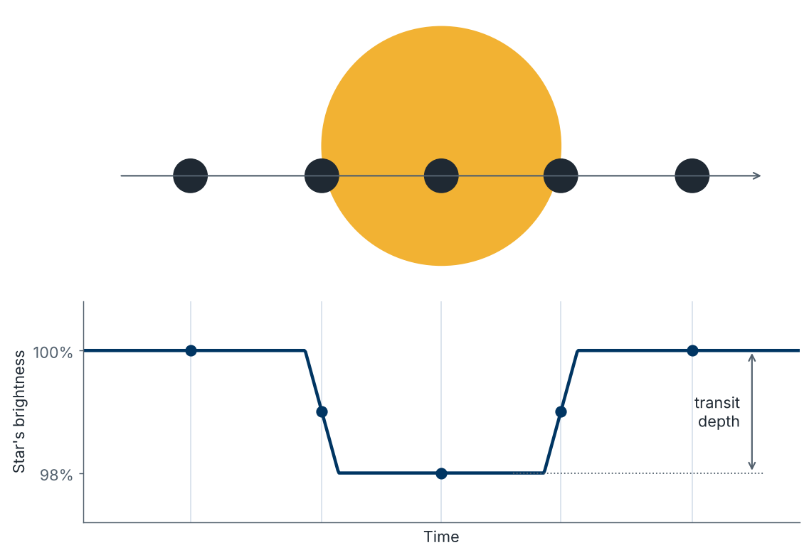
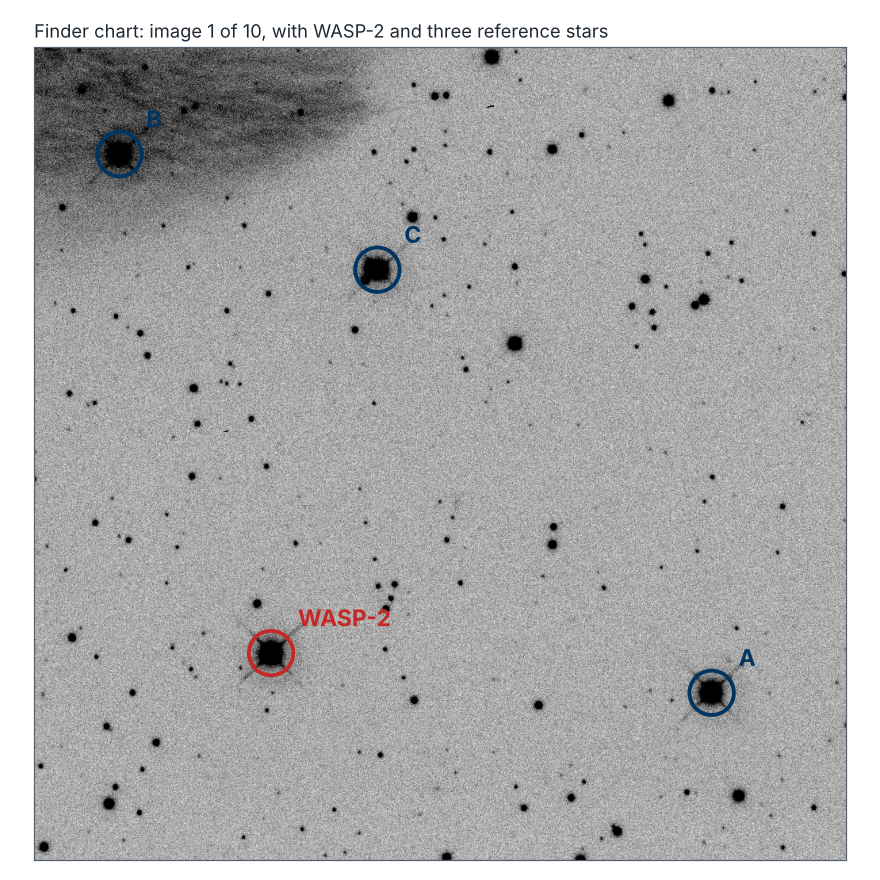
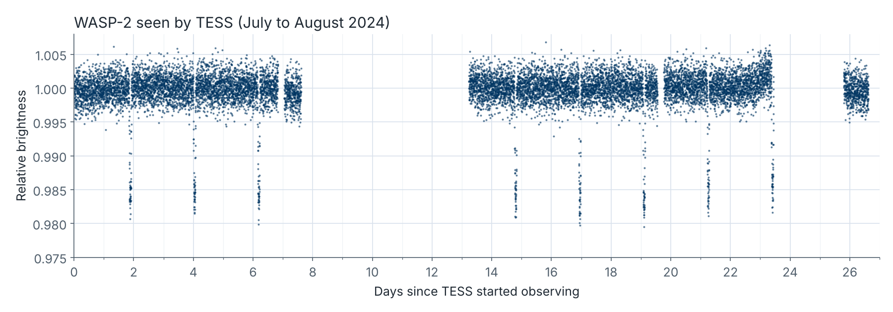
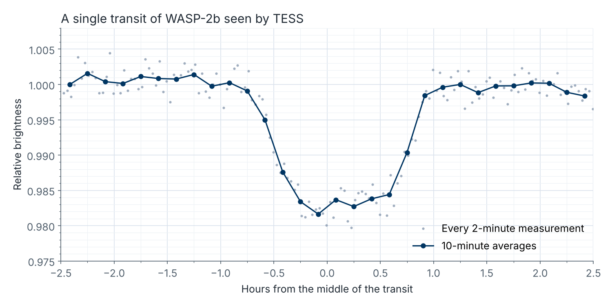

# AstroLab C2: Hunting Exoplanets

Watch a planet cross in front of its star, first through a telescope on the ground and then from space.

| Time | Software | Activities | Submit |
| :-: | :-: | :-: | :-: |
| About 2 hours | AstroImageJ | Differential photometry, reading light curves | The C2 proforma on Canvas |

**Start here:** download the [AstroLab C2 proforma](https://github.com/mjcowley/astrolabs/raw/main/C2/AstroLabC2_Proforma.docx) and fill it in as you go. When you've finished both parts, submit it as a Word document or PDF on the *Assignments* page on Canvas by the due date.

**Contents:** [Overview](#overview) · [How to complete this AstroLab](#how-to-complete-this-astrolab) · [Software and data](#software-and-data) · [Part 1: Find the transit yourself](#part-1-find-the-transit-yourself) · [Part 2: The same planet from space](#part-2-the-same-planet-from-space) · [Troubleshooting](#troubleshooting) · [Optional extension](#optional-extension)

## Overview

An [exoplanet](http://astro.vaporia.com/start/exoplanet.html) is a planet orbiting a star other than the Sun. Exoplanets are far too faint and too close to their stars to photograph directly, except in a handful of cases. Instead, astronomers find most of them indirectly, and the most successful method has found [thousands](https://exoplanetarchive.ipac.caltech.edu/), the transit method.

If a planet's orbit happens to be lined up with our view, then once every orbit the planet passes in front of its star and blocks a tiny fraction of its light. The star dims slightly for an hour or two, then recovers. A plot of a star's brightness over time is called a light curve, and a transit shows up as a small, flat-bottomed dip.

*A transit: as the planet moves across the star, the star's brightness dips. The size of the dip is the transit depth.*

The dip is small, usually a couple of percent or less, so measuring is a challenge. Earth's atmosphere makes stars flicker and fade, and the star sinks lower in the sky during the night. The solution is differential photometry, which is a measure the target star *and* some nearby reference stars in every image. The atmosphere affects them all in the same way, so comparing the target with the reference stars cancels it out and leaves only the real change in the target.

In this AstroLab you'll study WASP-2b, a giant planet discovered in 2006 by the UK's Wide Angle Search for Planets (WASP). In Part 1, you'll use AstroImageJ to measure its transit in ten images from a 2-metre telescope on the ground. In Part 2, you'll compare your result with the same planet seen by NASA's TESS space telescope, and use both light curves to work out what kind of planet it is.

**By the end of this AstroLab you'll be able to:**

* explain how the transit method finds exoplanets
* use differential photometry in AstroImageJ to build a light curve
* explain why astronomers compare a target star with reference stars
* read a transit's depth, duration and period from a light curve, and explain what each tells us about a planet
* explain why space telescopes and many measurements are needed to find small planets

## How to complete this AstroLab

You can complete C2 on campus in your scheduled session, or remotely in your own time. The steps are the same either way, and everyone submits the same proforma.

**On campus**

* Come to your scheduled AstroLab session. AstroImageJ is already installed on the lab computers.
* The teaching team will run a live demonstration and help you as you go.

**Remote**

* Watch the walkthrough recording on Echo360 (on Canvas). It covers everything from the live session.
* Install AstroImageJ on your own computer, or use QUT's Virtual Desktop Infrastructure (see [Software and data](#software-and-data)).
* Work through [Before you start](#before-you-start) first, so setup problems don't hold you up.
* If you get stuck, contact the teaching team.

## Software and data

This AstroLab uses AstroImageJ, a free and open-source application for measuring the brightness of stars in astronomical images. It's pre-installed on QUT's lab computers. To use your own computer, download the version for your system from the [AstroImageJ website](https://www.astro.louisville.edu/software/astroimagej/), which also has installation help for each system. If you'd rather not install anything, you can use AstroImageJ through [QUT's Virtual Desktop Infrastructure](https://gist.github.com/mjcowley/fe60fae650deedb8ea3b4d21cf274365).

Click a file name below to download it.

| File | What it is | Size |
| --- | --- | --- |
| [wasp2_lco_images.zip](https://github.com/mjcowley/astrolabs/raw/main/data/C2/wasp2_lco_images.zip) | Ten images of WASP-2 (Part 1) | 9 MB |
| [wasp2_tess_sector81.csv](https://github.com/mjcowley/astrolabs/raw/main/data/C2/wasp2_tess_sector81.csv) | TESS light curve of WASP-2 (optional extension only) | 0.2 MB |

The images were taken on 5 October 2008 with the 2-metre Faulkes Telescope North in Hawai'i, now part of the [Las Cumbres Observatory](https://lco.global/) global telescope network. Each is a 15-second exposure, and they're spread over about two hours.

### Before you start

If you're working remotely, do these first:

1. Install AstroImageJ and check it opens.
2. Download `wasp2_lco_images.zip` and unzip it into a new, empty folder. You should have ten files, `wasp2_lco_01.fits` to `wasp2_lco_10.fits`.
3. Download the [AstroLab C2 proforma](https://github.com/mjcowley/astrolabs/raw/main/C2/AstroLabC2_Proforma.docx) so you can fill it in as you go.

## Part 1: Find the transit yourself

1. Watch for background information session if you're on campus, or the recording on Echo360 (on Canvas) if you're remote.

2. In AstroImageJ, select ***File***, ***Import***, ***Image Sequence***. Select the folder containing your ten images (Mac), or any one of the images inside it (Windows), and click ***Open***. In the window that appears, type `wasp2` in ***File name contains*** so only the ten images are loaded. If your computer is short of memory, also tick ***Use virtual stack***. Click ***OK***.

3. Look through the images, and if they look blank or washed out, click the ***Auto brightness and contrast*** button in the image window's toolbar. Use the left and right arrow keys to step through the images, watching the counter (1/10, 2/10, and so on) at the top left. You'll notice the stars shift slightly between images, because the telescope didn't point at exactly the same spot each time.

4. Line up the images by selecting ***Process***, ***Align stack using WCS***. Check that all slices are selected (first slice 1, last slice 10), tick ***Use only WCS headers for alignment***, leave everything else as it is, and click ***OK***. Step through the images again: the stars should now stay still. (The WCS is information stored in each image that links its pixels to positions on the sky.)

5. Use the finder chart below to find WASP-2 and three suitable reference stars, A, B and C, in your images.

   

6. **Set up the apertures.** Click the ***Multi-aperture*** button in the image window's toolbar. Set the ***Radius of object aperture*** to 8 pixels, the ***Inner radius of background annulus*** to 14 and the ***Outer radius of background annulus*** to 20. Tick ***Use RA/Dec to locate aperture positions*** and untick ***Auto comparison stars*** if it's ticked. Leave everything else as it is and click ***Place Apertures***.

   The inner circle (the aperture) collects the star's light. The ring from 14 to 20 pixels (the background annulus) measures the glow of the sky around the star, which AstroImageJ subtracts. The gap between them keeps any of the star's light out of the background measurement.

7. **Select the stars.** Left-click on WASP-2 first, then on reference stars A, B and C. WASP-2 will be labelled T1 (the target), and the reference stars C2, C3 and C4 (the comparison stars). When you've selected all four, right-click anywhere in the image to run the measurements.

8. **Plot the light curve.** Several windows will open. The two that matter are ***Plot of Measurements*** and ***Multi-plot Y-data***. In the ***Multi-plot Y-data*** window, tick the ***Lines*** box for your data sets to join the points. The ***Plot of Measurements*** window now shows your light curve: the brightness of WASP-2 compared with the reference stars, in each of the ten images.

9. **Capture your light curve.** Take a screenshot of the ***Plot of Measurements*** window and paste it into Part 1 of your proforma. Then use your light curve to estimate the transit depth (how far the brightness drops, as a percentage), and which images were taken during the transit.

10. **Look at the raw measurements.** Find the ***Measurements*** table window. Each row is one image, and the columns `Source-Sky_T1`, `Source-Sky_C2`, `Source-Sky_C3` and `Source-Sky_C4` give the raw brightness of each star after the sky has been subtracted. Compare the first image with the last for each star. Record what you notice in your proforma, then answer the Part 1 questions.

<b>How were the aperture sizes chosen?</b> (optional)

Stars aren't sharp points in an image. Earth's atmosphere blurs each one into a small disc, and how much depends on the conditions on the night (astronomers call this the *seeing*). To choose the apertures, click the ***Single aperture*** button, click on WASP-2, then select ***Analyze***, ***Plot seeing profile***. The plot shows how the star's brightness falls off with distance from its centre. For these images, almost all of WASP-2's light is within 8 pixels, and by 14 pixels there's only sky left. An aperture that's too small misses some of the star's light; one that's too big adds extra noise from the sky and can catch light from neighbouring stars.

## Part 2: The same planet from space

NASA's Transiting Exoplanet Survey Satellite (**TESS**) has been scanning almost the whole sky for transiting planets since 2018. It watches each patch of sky for about 27 days without a break, measuring the brightness of every bright star every few minutes. In July and August 2024, it watched WASP-2.

The first plot shows the whole of that TESS observation, with a measurement every 2 minutes. The gap in the middle is when TESS paused to send its data back to Earth.

The second plot zooms in on one of those dips. The grey dots are the individual 2-minute measurements, and the dark line joins 10-minute averages so the shape is easier to see.

1. **Count the transits.** On the first plot, count the transits and read off roughly when each one happens.

2. **Measure the period.** The time between one transit and the next is the planet's orbital period, the length of its year. Use neighbouring transits to work it out, in days. Can you spot where some transits are missing?

3. **Measure the depth and duration.** On the second plot, read off the transit depth (as a percentage) and how long the transit lasts, from when the brightness starts to fall to when it's fully recovered.

4. **Compare.** Put your own light curve from Part 1 next to the TESS plots. Record your measurements in the table in your proforma, then answer the Part 2 questions and the reflection.

**Finished?** Submit your completed proforma on the *Assignments* page on Canvas.

## Troubleshooting

* If the images look blank or washed out, click ***Auto brightness and contrast***.
* If the import loads the wrong files, or none, check you typed `wasp2` in ***File name contains***, and that the ten images are in their own folder.
* If the apertures drift off the stars, check you aligned the images (Part 1, step 4) and ticked ***Use RA/Dec to locate aperture positions***.
* If your light curve is very noisy or shows no dip:
  * check that T1 is WASP-2 and that C2 to C4 are the reference stars on the finder chart;
  * check the aperture sizes are 8, 14 and 20 pixels;
  * make sure no other star falls inside any aperture or background ring.
* If AstroImageJ is very slow, tick ***Use virtual stack*** when importing, or use the lab computers or VDI.

Part of the learning process is working out why something went wrong, so if your light curve looks odd, re-check your choices and try again.

## Optional extension

The TESS light curve is also available as a [CSV file](https://github.com/mjcowley/astrolabs/raw/main/data/C2/wasp2_tess_sector81.csv), with the days since TESS started observing in the first column and the relative brightness in the second. Open it in Excel or Google Sheets and plot it yourself as a scatter plot. Can you zoom in on every transit and check they all have the same depth? How precisely can you pin down the period using the first and last transits?

To see what's been measured for WASP-2b by professional astronomers, look it up in the [NASA Exoplanet Archive](https://exoplanetarchive.ipac.caltech.edu/overview/WASP-2%20b).

## Credits

* Part 1: Faulkes Telescope North images of WASP-2 from the Las Cumbres Observatory archive.
* Part 2: TESS 2-minute light curve of WASP-2 (TIC 374530847, Sector 81) from the Mikulski Archive for Space Telescopes (MAST). Funding for the TESS mission is provided by NASA's Science Mission Directorate.
* The finder chart, transit diagram and TESS plots were made with [`tools/make_c2_data.py`](../tools/make_c2_data.py).
