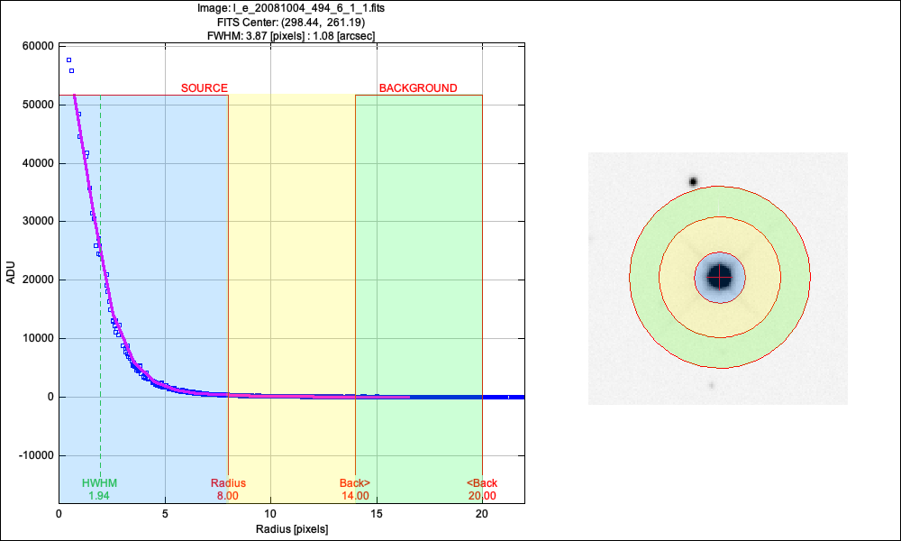
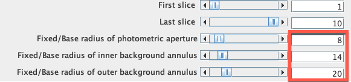
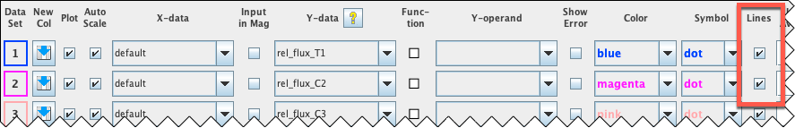

# AstroLab C2: Hunting Exoplanets

Watch a planet cross in front of its star, first through a telescope on the ground and then from space.

| Time | Software | Activities | Submit |
| :-: | :-: | :-: | :-: |
| About 2 hours | AstroImageJ | Differential photometry, reading light curves | The C2 proforma on Canvas |

**Start here:** download the [AstroLab C2 proforma](https://github.com/mjcowley/astrolabs/raw/main/C2/AstroLabC2_Proforma.docx) and fill it in as you go. When you've finished both parts, submit it as a Word document or PDF on the *Assignments* page on Canvas by the due date.

**Contents:** [Overview](#overview) · [How to complete this AstroLab](#how-to-complete-this-astrolab) · [Software and data](#software-and-data) · [Part 1: Meet WASP-2b and find its transit](#part-1-meet-wasp-2b-and-find-its-transit) · [Part 2: The same planet from space](#part-2-the-same-planet-from-space) · [Troubleshooting](#troubleshooting) · [Optional extension](#optional-extension)

## Overview

An [exoplanet](http://astro.vaporia.com/start/exoplanet.html) is a planet orbiting a star other than the Sun. Exoplanets are far too faint and too close to their stars to photograph directly, except in a handful of cases. Instead, astronomers find most of them indirectly, and the most successful method, the transit method, has found [thousands](https://exoplanetarchive.ipac.caltech.edu/).

If a planet's orbit happens to be lined up with our view, then once every orbit the planet passes in front of its star and blocks a tiny fraction of its light. The star dims slightly while the planet crosses it, which can take anything from under an hour to more than a day depending on the planet's orbit, then recovers. A plot of a star's brightness over time is called a light curve, and a transit shows up as a small, flat-bottomed dip, as below.

*A transit: as the planet moves across the star, the star's brightness dips. The size of the dip is the transit depth.*

The dip is usually small. A planet the size of Jupiter crossing a star like the Sun dims it by about 1%, and an Earth-sized planet by only about 0.01%, so measuring it is a challenge. Earth's atmosphere makes stars flicker and fade, and the star sinks lower in the sky during the night. The solution is differential photometry, which means measuring the target star *and* some nearby reference stars in every image. The atmosphere affects them all in the same way, so comparing the target with the reference stars cancels it out and leaves only the real change in the target.

In this AstroLab you'll study WASP-2b, a giant planet discovered in 2006 by the UK's [Wide Angle Search for Planets](https://wasp-planets.net/) (WASP). In Part 1, you'll explore WASP-2b in a professional exoplanet archive, track down its star in ten images from a 2-metre telescope on the ground, and use AstroImageJ to measure its transit yourself. In Part 2, you'll compare your result with the same planet seen by NASA's [TESS](https://science.nasa.gov/mission/tess/) space telescope, use both light curves to work out what kind of planet it is, and see how measurements like yours reveal a planet's size, orbit and temperature.

**By the end of this AstroLab you'll be able to:**

* explain how the transit method finds exoplanets, and why it's better at finding some kinds of planets and planetary systems than others
* look up an exoplanet in a professional archive, and find a star in your own images using an online sky atlas
* choose reference stars and an aperture size, and use differential photometry in AstroImageJ to build a light curve
* read a transit's depth, duration and period from a light curve, and explain what each tells us about a planet
* explain why space telescopes and many measurements are needed to find small planets

## How to complete this AstroLab

You can complete C2 on campus in your scheduled session, or remotely in your own time. The steps are the same either way, and everyone submits the same proforma.

**On campus**

* Come to your scheduled AstroLab session. AstroImageJ is already installed on the lab computers.
* The teaching team will run a background information session and help you as you go.

**Remote**

* Watch the recording of the background information session on Echo360 (on Canvas). It covers everything from the live session.
* Install AstroImageJ on your own computer, or use QUT's Virtual Desktop Infrastructure (see [Software and data](#software-and-data)).
* Work through [Before you start](#before-you-start) first, so setup problems don't hold you up.
* If you get stuck, contact the teaching team.

## Software and data

This AstroLab uses AstroImageJ, a free and open-source application for measuring the brightness of stars in astronomical images. It's pre-installed on QUT's lab computers. To use your own computer, download the version for your system from the [AstroImageJ website](https://www.astro.louisville.edu/software/astroimagej/), which also has installation help for each system. If you'd rather not install anything, you can use AstroImageJ through [QUT's Virtual Desktop Infrastructure](https://gist.github.com/mjcowley/fe60fae650deedb8ea3b4d21cf274365).

You'll also use two free websites in your browser: the [NASA Exoplanet Archive](https://exoplanetarchive.ipac.caltech.edu/), the professional catalogue of every confirmed exoplanet, and [Aladin Lite](https://aladin.cds.unistra.fr/AladinLite/), an online atlas of the whole sky.

Click a file name below to download it.

| File | What it is | Size |
| --- | --- | --- |
| [wasp2_lco_images.zip](https://github.com/mjcowley/astrolabs/raw/main/data/C2/wasp2_lco_images.zip) | Ten images of WASP-2 (Part 1) | 9 MB |
| [wasp2_tess_sector81.csv](https://github.com/mjcowley/astrolabs/raw/main/data/C2/wasp2_tess_sector81.csv) | TESS light curve of WASP-2 (optional extension only) | 0.2 MB |

The images were taken on 5 October 2008 with the 2-metre Faulkes Telescope North on Haleakalā in Hawai'i, now part of the [Las Cumbres Observatory](https://lco.global/) global telescope network. Each is a 15-second exposure, and they're spread over about two hours.

### Before you start

If you're working remotely, do these first:

1. Install AstroImageJ and check it opens.
2. Download `wasp2_lco_images.zip` and unzip it into a new, empty folder. You should have ten files, `wasp2_lco_01.fits` to `wasp2_lco_10.fits`.
3. Download the [AstroLab C2 proforma](https://github.com/mjcowley/astrolabs/raw/main/C2/AstroLabC2_Proforma.docx) so you can fill it in as you go.

## Part 1: Meet WASP-2b and find its transit

### Meet WASP-2b

1. Watch the background information session if you're on campus, or the recording on Echo360 (on Canvas) if you're remote.

2. Look up WASP-2b in the professional catalogue by opening its page in the [NASA Exoplanet Archive](https://exoplanetarchive.ipac.caltech.edu/overview/WASP-2%20b). Find the discovery year and method, the orbital period, the planet's radius and mass (in Jupiter radii and Jupiter masses), the distance to the system and the temperature of its star, and record them in the table in your proforma. Distances in the archive are in parsecs, and one parsec is 3.26 light-years.

3. Look up [51 Pegasi b](https://exoplanetarchive.ipac.caltech.edu/overview/51%20Peg%20b), the first planet found orbiting a Sun-like star (it won the 2019 Nobel Prize in Physics), and record the same details. Then look at the archive's [count of confirmed planets by discovery method](https://exoplanetarchive.ipac.caltech.edu/docs/counts_detail.html), and note how many planets have been found by transits compared with the total.

### Find WASP-2 in your images

4. In AstroImageJ, select ***File***, ***Import***, ***Image Sequence***. Select the folder containing your ten images (Mac), or any one of the images inside it (Windows), and click ***Open***. In the window that appears, type `wasp2` in ***File name contains*** so only the ten images are loaded. If your computer is short of memory, also tick ***Use virtual stack***. Click ***OK***.

5. Look through the images, and if they look blank or washed out, click the ***Auto brightness and contrast*** button in the image window's toolbar. Use the left and right arrow keys to step through the images, watching the counter (1/10, 2/10, and so on) at the top left. You'll notice the stars shift slightly between images, because the telescope didn't point at exactly the same spot each time.

6. Line up the images by selecting ***Process***, ***Align stack using WCS***. Check that all slices are selected (first slice 1, last slice 10), tick ***Use only WCS headers for alignment***, leave everything else as it is, and click ***OK***. Step through the images again: the stars should now stay still. (The WCS is information stored in each image that links its pixels to positions on the sky.)

7. Track down WASP-2 by opening [Aladin Lite](https://aladin.cds.unistra.fr/AladinLite/), typing `WASP-2` in the search box and pressing Enter, which centres the view on the star. Zoom until the view is about 5 arcminutes across (the size is shown at the bottom of the screen), so it covers the same patch of sky as your images, then match the pattern of stars around WASP-2 with the pattern in your image. In both, north should be up and east to the left, but check the small north and east arrows in the corner of the AstroImageJ window. To confirm you've found the right star, hover your mouse over it in AstroImageJ: the RA and Dec shown at the top of the window should read about 20:30:54 and +06:25:46.

8. Choose three reference stars in your image. Good reference stars are about as bright as WASP-2 or a little fainter, have no other stars close by that could fall inside their apertures, and aren't so bright that their centres look flat or burnt out. Avoid the hazy patch at the top left of the image, which is light scattered inside the telescope. Note roughly where your three stars are, so you can describe them in your proforma.

### Measure the transit

9. Check how big WASP-2 appears in your images by clicking the ***Single aperture*** button in the toolbar, clicking on WASP-2, then selecting ***Analyze***, ***Plot seeing profile***. The plot shows how WASP-2's brightness falls off with distance from its centre. Stars aren't sharp points in an image, because Earth's atmosphere blurs each one into a small disc, and the width of that disc is the FWHM (full width at half maximum), shown at the top of the plot. AstroImageJ uses it to suggest an aperture radius (the blue *SOURCE* region) and a background annulus (the green *BACKGROUND* region), with a gap between them that's ignored. Record the FWHM and the three radii in your proforma, check that the aperture radius is about 1.5 to 2 times the FWHM, as you saw in the background session, and click ***Save Aperture***.

   

   *An example seeing profile of WASP-2 in the first image (the image name at the top is the file's original archive name). Yours may differ slightly depending on exactly where you click.*

10. Set up the measurement by clicking the ***Multi-aperture*** button in the toolbar, and check that the three radii you saved have been loaded into the ***Fixed/Base radius*** boxes, as below. Tick ***Use RA/Dec to locate aperture positions***, untick ***Auto comparison stars*** if it's ticked, leave everything else as it is and click ***Place Apertures***.

    

11. Select the stars by left-clicking on WASP-2 first, then on your three reference stars. WASP-2 will be labelled T1 (the target), and your reference stars C2, C3 and C4 (the comparison stars). When you've selected all four, right-click anywhere in the image to run the measurements.

12. Several windows will open, and the two that matter are ***Plot of Measurements*** and ***Multi-plot Y-data***. In the ***Multi-plot Y-data*** window, tick the ***Lines*** box for each data set to join the points, as below. The ***Plot of Measurements*** window now shows your light curve: the brightness of WASP-2 compared with your reference stars in each of the ten images.

    

13. Take a screenshot of the ***Plot of Measurements*** window and paste it into Part 1 of your proforma. Then use your light curve to estimate the transit depth (how far the brightness drops, as a percentage), and which images were taken during the transit.

14. Find the ***Measurements*** table window, where each row is one image and the columns `Source-Sky_T1`, `Source-Sky_C2`, `Source-Sky_C3` and `Source-Sky_C4` give the raw brightness of each star after the sky has been subtracted. Compare the first image with the last for each star, record what you notice in your proforma, then answer the Part 1 questions.

## Part 2: The same planet from space

NASA's Transiting Exoplanet Survey Satellite (TESS) has been scanning almost the whole sky for transiting planets since 2018. It watches each patch of sky for about 27 days without a break, measuring the brightness of every bright star every few minutes. In July and August 2024, it watched WASP-2.

The first plot shows the whole of that TESS observation, with a measurement every 2 minutes. The gap in the middle is when TESS paused to send its data back to Earth.

The second plot zooms in on one of those dips. The grey dots are the individual 2-minute measurements, and the dark line joins 10-minute averages so the shape is easier to see.

1. Count the transits on the first plot, and read off roughly when each one happens.

2. Work out the planet's orbital period, the length of its year, from the time between neighbouring transits, in days. Can you spot where some transits are missing, and when the next transit after the end of the data would have happened?

3. Read off the transit depth (as a percentage) from the second plot, and how long the transit lasts, from when the brightness starts to fall to when it's fully recovered.

4. Compare your own light curve from Part 1 with the TESS plots, record your measurements in the table in your proforma, then answer the Part 2 questions and the reflection.

### From light curve to planet

How did astronomers work out the planet properties you recorded from the archive in Part 1? Mostly from exactly the kind of measurements you've just made. Here's how, using round numbers from the TESS light curve (a transit depth of 1.7%, a period of 2.15 days and a duration of 1.7 hours) together with WASP-2's radius (0.82 times the Sun's), mass (0.85 times the Sun's) and temperature (5,170 K), which astronomers measure from the star's light. You don't need to do these calculations yourself, but see how each one turns a measurement into a property of the planet.

**The planet's size comes from the transit depth.** The dip is the fraction of the star's disc the planet covers, so it depends on the ratio of their areas:

$$\text{depth} = \left(\frac{R_\text{planet}}{R_\text{star}}\right)^2 \quad\Rightarrow\quad R_\text{planet} = R_\text{star}\sqrt{\text{depth}} = 0.82\,R_\odot \times \sqrt{0.017} \approx 0.107\,R_\odot \approx 1.04 \text{ Jupiter radii}$$

That's within a few per cent of the archive's value, and it's why WASP-2b counts as a giant planet.

**The size of its orbit comes from the period.** Kepler's third law links a planet's orbital period to its distance from its star. In units of years, astronomical units (AU, the Earth–Sun distance) and solar masses, it's simply:

$$a^3 = M_\text{star}\,P^2 \quad\Rightarrow\quad a = \left(0.85 \times \left(\frac{2.15}{365.25}\right)^2\right)^{1/3} \approx 0.031 \text{ AU}$$

WASP-2b orbits about 13 times closer to its star than Mercury does to the Sun.

**Its temperature comes from that distance.** A planet this close is heated fiercely by its star. Balancing the starlight it absorbs against the heat it radiates gives a rough temperature:

$$T_\text{planet} \approx T_\text{star}\sqrt{\frac{R_\text{star}}{2a}} \approx 5170 \text{ K} \times \sqrt{\frac{0.0038 \text{ AU}}{2 \times 0.031 \text{ AU}}} \approx 1300 \text{ K}$$

That's hot enough to melt lead and aluminium, and far too hot for liquid water.

**The duration tells us how the planet crosses its star.** In a circular orbit of 0.031 AU every 2.15 days, WASP-2b moves at about 156 km/s, so in 1.7 hours it travels about 960,000 km. That's less than the star's diameter (about 1.1 million km), so the planet can't be crossing the middle of the star. It must cut across nearer the edge, like a chord across a circle. Astronomers use the exact shape and length of the transit to work out how the orbit is tilted.

**What a transit can't tell us is the planet's mass.** A transit shows how big a planet is, but not how heavy. For that, astronomers measure the tiny wobble the planet's gravity gives its star, the same method that found 51 Pegasi b. Combining the two, WASP-2b's size and mass give its density: it's a gas giant, a little less dense than Jupiter.

**Finished?** Submit your completed proforma on the *Assignments* page on Canvas.

## Troubleshooting

* If the images look blank or washed out, click ***Auto brightness and contrast***.
* If the import loads the wrong files, or none, check you typed `wasp2` in ***File name contains***, and that the ten images are in their own folder.
* If you can't match the pattern in Aladin Lite, zoom out a little further, and check the north and east arrows in AstroImageJ. Hovering over a star in AstroImageJ to read its RA and Dec is the surest check.
* If the apertures drift off the stars, check you aligned the images (Part 1, step 6) and ticked ***Use RA/Dec to locate aperture positions***.
* If your light curve is very noisy or shows no dip:
  * check that T1 is WASP-2, using its RA and Dec
  * check your reference stars aren't much brighter or fainter than WASP-2, and aren't in the hazy patch
  * make sure no other star falls inside any aperture or background ring
  * check the aperture radii match your seeing profile
* If AstroImageJ is very slow, tick ***Use virtual stack*** when importing, or use the lab computers or VDI.

Part of the learning process is working out why something went wrong, so if your light curve looks odd, re-check your choices and try again.

## Optional extension

The TESS light curve is also available as a [CSV file](https://github.com/mjcowley/astrolabs/raw/main/data/C2/wasp2_tess_sector81.csv), with the days since TESS started observing in the first column and the relative brightness in the second. Open it in Excel or Google Sheets and plot it yourself as a scatter plot. Can you zoom in on every transit and check they all have the same depth? How precisely can you pin down the period using the first and last transits?

## Credits

* Part 1: Faulkes Telescope North images of WASP-2 from the Las Cumbres Observatory archive. Sky atlas: Aladin Lite (CDS, Strasbourg). Planet data from the NASA Exoplanet Archive, operated by Caltech under contract with NASA.
* Part 2: TESS 2-minute light curve of WASP-2 (TIC 374530847, Sector 81) from the Mikulski Archive for Space Telescopes (MAST). Funding for the TESS mission is provided by NASA's Science Mission Directorate.
* The transit diagram and TESS plots were made with [`tools/make_c2_data.py`](../tools/make_c2_data.py).
