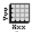
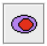
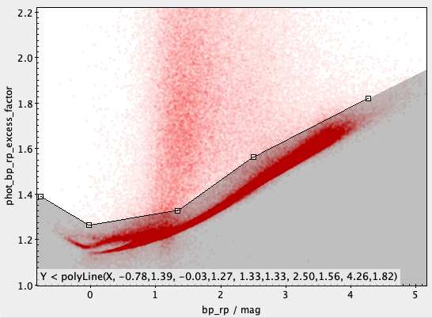

# AstroLab C4: Studying Stellar Evolution with Gaia

Ask a space telescope about the stars next door, and build your own Hertzsprung–Russell diagram.

| Time | Software | Activities | Submit |
| :-: | :-: | :-: | :-: |
| About 2 hours | TOPCAT | Querying the Gaia archive, building and reading an H–R diagram | The C4 proforma on Canvas |

**Start here:** download the [AstroLab C4 proforma](https://github.com/mjcowley/astrolabs/raw/main/C4/AstroLabC4_Proforma.docx) and fill it in as you go. When you've finished both parts, submit it as a Word document or PDF on the *Assignments* page on Canvas by the due date.

**Contents:** [Overview](#overview) · [How to complete this AstroLab](#how-to-complete-this-astrolab) · [Software and data](#software-and-data) · [Part 1: The stars next door](#part-1-the-stars-next-door) · [Part 2: A family of stars](#part-2-a-family-of-stars) · [Troubleshooting](#troubleshooting) · [Optional extension](#optional-extension)

## Overview

[Gaia](https://www.esa.int/Science_Exploration/Space_Science/Gaia) is a European Space Agency (ESA) space telescope, launched in December 2013, that has made the largest and most precise three-dimensional map of our Galaxy. It measured the positions, distances, motions, brightnesses and colours of nearly two billion stars, about 1% of the stars in the Milky Way. Its third data release (DR3), published in 2022, is the data you'll use in this AstroLab.


*An artist's impression of the Gaia spacecraft (image: ESA).*

One of the most important tools in astronomy is the Hertzsprung–Russell (H–R) diagram, which plots how bright stars really are against their temperature. In 1911, the Danish astronomer Ejnar Hertzsprung plotted the brightness of stars against their colour, and in 1913 the American astronomer Henry Norris Russell independently plotted brightness against spectral class. Both found that stars don't fall just anywhere. Instead, they gather into a few distinct groups, and those groups turned out to be the key to understanding how stars live and die.

A star's colour and spectral class both measure its surface temperature. Hot stars are blue-white and cool stars are red, and astronomers sort stars into spectral classes by the features in their spectra:

| Class | Spectral features | Surface temperature | Colour |
| :-: | --- | --- | --- |
| O | Ionised helium | Above 30,000 K | Blue |
| B | Neutral helium, some hydrogen | 10,000 to 30,000 K | Blue-white |
| A | The strongest hydrogen lines | 7,500 to 10,000 K | White |
| F | Weaker hydrogen, ionised calcium | 6,000 to 7,500 K | Yellow-white |
| G | Ionised calcium, neutral metals | 5,200 to 6,000 K | Yellow (the Sun is a G star) |
| K | Neutral metals | 3,700 to 5,200 K | Orange |
| M | Molecules such as titanium oxide | Below 3,700 K | Red |

In this AstroLab you'll use TOPCAT to download Gaia's measurements of the stars near the Sun, turn them into an H–R diagram, clean out the unreliable measurements, and explore what the diagram tells us. In Part 2, you'll find a cluster of stars that were all born together, and see how its H–R diagram reveals the cluster's age.

**By the end of this AstroLab you'll be able to:**

* query a professional astronomy archive and work with a large table of stars in TOPCAT
* build an H–R diagram from parallaxes, magnitudes and colours
* explain why astronomers remove unreliable measurements, and how
* identify the main sequence, giants and white dwarfs, and explain what makes each group different
* find a star cluster from the motions of its stars, and explain what its H–R diagram tells us about its age

## How to complete this AstroLab

You can complete C4 on campus in your scheduled session, or remotely in your own time. The steps are the same either way, and everyone submits the same proforma.

**On campus**

* Come to your scheduled AstroLab session. TOPCAT is already installed on the lab computers.
* The teaching team will run a background information session and help you as you go.

**Remote**

* Watch the recording of the background information session on Echo360 (on Canvas). It covers everything from the live session.
* Install TOPCAT on your own computer, or use QUT's Virtual Desktop Infrastructure (see [Software and data](#software-and-data)).
* Work through [Before you start](#before-you-start) first, so setup problems don't hold you up.
* If you get stuck, contact the teaching team.

## Software and data

This AstroLab uses [TOPCAT](https://www.star.bris.ac.uk/~mbt/topcat/) (Tool for OPerations on Catalogues And Tables), a free and open-source application for exploring large tables of astronomical data. It's pre-installed on QUT's lab computers. To use your own computer, download the version for your system from the TOPCAT website, which also has installation help and a full [user guide](https://www.star.bris.ac.uk/~mbt/topcat/sun253/index.html). If you'd rather not install anything, you can use TOPCAT through [QUT's Virtual Desktop Infrastructure](https://gist.github.com/mjcowley/fe60fae650deedb8ea3b4d21cf274365).

In Part 1 you'll download your own data straight from the Gaia archive. The files below are provided too. Click a file name to download it.

| File | What it is | Size |
| --- | --- | --- |
| [gaia_dr3_taurus.fits](https://github.com/mjcowley/astrolabs/raw/main/data/C4/gaia_dr3_taurus.fits) | Stars within 100 parsecs in the patch of sky around the Hyades (Part 2) | 0.5 MB |
| [gaia_dr3_50pc.fits](https://github.com/mjcowley/astrolabs/raw/main/data/C4/gaia_dr3_50pc.fits) | A backup of the Part 1 query, in case the Gaia archive is busy | 2.6 MB |
| [gaia_dr3_100pc.fits](https://github.com/mjcowley/astrolabs/raw/main/data/C4/gaia_dr3_100pc.fits) | Every star within 100 parsecs (optional extension only) | 20 MB |

Each file is a table with one row per star and these columns:

| Column | What it means |
| --- | --- |
| `source_id` | Gaia's identification number for the star |
| `ra`, `dec` | Position on the sky (right ascension and declination, in degrees) |
| `parallax` | How much the star appears to shift as Earth orbits the Sun, in milliarcseconds. Nearer stars shift more |
| `pmra`, `pmdec` | Proper motion, how fast the star moves across the sky, in milliarcseconds per year |
| `phot_g_mean_mag` | Apparent magnitude (how bright the star looks from here) in Gaia's G band, which covers about 330 to 1050 nm |
| `bp_rp` | BP−RP colour, the difference between the star's magnitudes in Gaia's blue (BP) and red (RP) bands |
| `ruwe` | A measure of how well Gaia's measurements of the star's position fit a single, well-behaved star |
| `phot_bp_rp_excess_factor` | A check on whether the BP and RP brightnesses add up as they should |

### Before you start

If you're working remotely, do these first:

1. Install TOPCAT and check it opens.
2. Download `gaia_dr3_taurus.fits` and `gaia_dr3_50pc.fits`.
3. Download the [AstroLab C4 proforma](https://github.com/mjcowley/astrolabs/raw/main/C4/AstroLabC4_Proforma.docx) so you can fill it in as you go.

## Part 1: The stars next door

### Ask Gaia for the data

1. Watch the background information session if you're on campus, or the recording on Echo360 (on Canvas) if you're remote.

2. Connect to the Gaia archive by selecting ***VO***, ***Table Access Protocol (TAP) Query*** from TOPCAT's main window. In the list of services, find and select the ESA Gaia archive (or type `https://gea.esac.esa.int/tap-server/tap` into ***TAP URL***), then click ***Use Service***.

3. Type the query below into the ***ADQL Text*** box. It's written in ADQL (Astronomical Data Query Language), the language astronomers use to search large catalogues, and it asks for every star with a parallax greater than 20 milliarcseconds, which means every star within 50 parsecs (about 160 light-years), whose parallax and colours are measured precisely.

   ```sql
   SELECT source_id, ra, dec, parallax, pmra, pmdec,
          phot_g_mean_mag, bp_rp, ruwe, phot_bp_rp_excess_factor
   FROM gaiadr3.gaia_source
   WHERE parallax > 20
     AND parallax_over_error > 10
     AND phot_bp_mean_flux_over_error > 10
     AND phot_rp_mean_flux_over_error > 10
   ```

4. Set ***Mode*** to *Asynchronous*, type `100000` in ***Max Rows***, and click ***Run Query***. After a minute or so, a table of about 40,000 stars will appear in TOPCAT's main window. Record the number of rows in your proforma. If the archive is slow or the query fails, load `gaia_dr3_50pc.fits` instead with ***File***, ***Load Table***, ***System Browser***.

5. Have a look at the data by clicking the ***Table Browser*** button in the main window's toolbar, which shows the table one star per row. The [table above](#software-and-data) explains each column.

### Build an H–R diagram

6. Work out how bright each star really is. Gaia measured each star's apparent magnitude, how bright it looks from Earth, but a star can look faint because it's dim or because it's far away. Astronomers compare stars using their absolute magnitude, how bright each would look from a standard distance of 10 parsecs, which we can calculate from the parallax. Click the ***Table Columns*** button , then the ***Add*** button , and create a new column with these details:

   ```
   Name:        g_abs
   Expression:  phot_g_mean_mag + 5*log10(parallax/100)
   Units:       mag
   ```

7. Plot the H–R diagram by clicking the ***Plane Plot*** button , setting ***X*** to `bp_rp` and ***Y*** to `g_abs`. The x-axis is now the star's colour, which tells us its temperature. Hot, blue stars have small or negative BP−RP values and cool, red stars have large ones, because a star's light shifts towards the blue as it gets hotter. To see why, open the [blackbody demo](https://mjcowley.github.io/astro_demos/blackbody/?filters=gaia), which shows the light given off by a star of any temperature over Gaia's BP and RP filters. Drag the temperature slider from cool to hot and watch how the light moves between the two filters, and how the BP−RP colour changes.

8. Turn the diagram the right way up by clicking the ***Axes*** control  in the plot window, then ticking ***Y Flip*** in the ***Coords*** tab. The magnitude scale runs backwards, with brighter stars having smaller numbers, so flipping the axis puts the brightest stars at the top, as astronomers always draw it.

9. Explore the different ways of shading the points in the plot window's ***Form*** tab, for example colouring them by another column using the ***Weighted*** mode. The plot is crowded, with tens of thousands of points on top of each other, and shading by density shows where most of the stars are.

### Clean the data

10. Remove the stars with unreliable positions and parallaxes. Gaia's measurements can go wrong for a star that's really two stars too close together to separate, or one in a crowded part of the sky, and a bad parallax gives a wrong absolute magnitude. The `ruwe` column flags these, with values close to 1 for a well-behaved star. Click the ***Row Subsets*** button  in the main window, then the ***Add*** button , and create a subset with these details:

    ```
    Subset Name:  astrom_ok
    Expression:   ruwe < 1.4
    ```

11. Remove the stars with unreliable colours. If another star's light spills into the measurement, or the star is in a crowded region, the brightnesses in the BP and RP bands don't add up as they should, and `phot_bp_rp_excess_factor` is higher than it ought to be for a star of that colour. Open a new ***Plane Plot***  with ***X*** set to `bp_rp` and ***Y*** set to `phot_bp_rp_excess_factor`. Most stars fall in a dense band, and the scattered points above it are the unreliable ones. Click the ***Draw Subset*** button , choose ***Below*** from the drop-down menu, and click a series of points just above the dense band so the shaded area covers it, as below. Click the ***Finish*** button , and name the subset `photom_ok`.

    

    If you can't get the drawing to work, you can type the same selection instead as a new subset in the ***Row Subsets*** window, using the expression `phot_bp_rp_excess_factor < polyLine(bp_rp, -0.78,1.39, -0.03,1.27, 1.33,1.33, 2.50,1.56, 4.26,1.82)`.

12. Combine the two by adding one more subset in the ***Row Subsets*** window:

    ```
    Subset Name:  ok
    Expression:   astrom_ok && photom_ok
    ```

    The ***Row Subsets*** window shows how many stars are in each subset. Record the number and percentage in the `ok` subset in your proforma.

13. Return to your H–R diagram, and in the ***Subsets*** tab, untick ***All*** and tick ***ok*** so only the reliable stars are plotted. Compare it with the diagram you had before, then take a screenshot of the cleaned H–R diagram and paste it into Part 1 of your proforma.

### Read the diagram

14. Find the three main groups of stars on your H–R diagram:

    * the main sequence, the long band running from the top left (hot and bright) to the bottom right (cool and faint), where stars spend most of their lives turning hydrogen into helium in their cores
    * the giants, the small group at the top right, which are cool but very bright
    * the white dwarfs, the band at the bottom left, which are hot but very faint

15. Find where the Sun would sit on your diagram. Seen from 10 parsecs away, the Sun would have an absolute magnitude of about 4.7 in Gaia's G band, and its BP−RP colour is about 0.82. Record what you notice in your proforma, then answer the Part 1 questions.

## Part 2: A family of stars

The stars near the Sun are a mixture of all ages, born at different times in different places. But stars are born in groups from the same cloud of gas, and for a while they travel through the Galaxy together, as a star cluster. The nearest star cluster to the Sun is the Hyades, in the constellation of Taurus. Its brightest stars form the "V" of the bull's face, a pattern that's easy to spot with the naked eye in the summer sky from Brisbane.

1. Load `gaia_dr3_taurus.fits` with ***File***, ***Load Table***, ***System Browser***. It contains every star within 100 parsecs in the patch of sky around the Hyades, chosen with the same kind of query you ran in Part 1. Add the `g_abs` column to this table as you did in Part 1, step 6, and the `ok` subset by typing it as a single expression in the ***Row Subsets*** window: `ruwe < 1.4 && phot_bp_rp_excess_factor < polyLine(bp_rp, -0.78,1.39, -0.03,1.27, 1.33,1.33, 2.50,1.56, 4.26,1.82)`.

2. Look for stars moving together by opening a ***Plane Plot*** with ***X*** set to `pmra` and ***Y*** set to `pmdec`, then zooming in (scroll with the mouse) on the range from about −200 to +300 on both axes. Most stars are scattered widely, each moving its own way, but one group of stars sits in a tight clump, all moving across the sky in the same direction at the same speed. That's the Hyades. Read off roughly where the centre of the clump is and record it in your proforma.

3. Select the cluster by drawing around the clump with the ***Draw Subset*** button , this time choosing ***Inside*** from the drop-down menu, and click the ***Finish*** button . Name the subset `hyades_motion`.

4. Check that the cluster's stars are also at the same distance by plotting a ***Histogram*** of `parallax` for the `hyades_motion` subset (the histogram button is next to the ***Plane Plot*** button in the main window). Most of the stars should pile up around one value. Record it in your proforma, and work out the cluster's distance in parsecs, which is 1000 divided by the parallax in milliarcseconds.

5. Remove the few stars that move like the cluster but are much nearer or farther away by adding one last subset:

   ```
   Subset Name:  hyades
   Expression:   hyades_motion && ok && parallax > 17 && parallax < 27
   ```

6. Plot the H–R diagram of the Hyades, using `bp_rp` and `g_abs` as in Part 1 and showing only the `hyades` subset, with ***Y Flip*** ticked. Take a screenshot and paste it into Part 2 of your proforma. Then compare it with your H–R diagram of the stars near the Sun, and answer the Part 2 questions and the reflection.

All the stars in the Hyades formed at about the same time, so the cluster is like a snapshot of stars of a single age. The most massive stars on the main sequence burn through their fuel fastest, so as a cluster ages, its main sequence is eaten away from the top, and the point where it stops, called the turn-off, moves down and to the right. Comparing the turn-off with computer models of how stars evolve gives the cluster's age. For the Hyades, it's about 650 million years, roughly a seventh of the Sun's age.

**Finished?** Submit your completed proforma on the *Assignments* page on Canvas.

## Troubleshooting

* If the query fails or seems stuck, check you chose *Asynchronous* mode and that the archive address is right. If the archive is busy, load `gaia_dr3_50pc.fits` instead.
* If you get exactly 2,000 or 50,000 rows, the archive has cut the results short. Raise ***Max Rows*** and run the query again.
* If a new column or subset gives an error, check the expression is typed exactly as shown, including capital letters, brackets and underscores.
* If your H–R diagram is upside down, tick ***Y Flip*** in the ***Axes*** control's ***Coords*** tab.
* If the plot doesn't change after making a subset, check the subset is ticked, and ***All*** is unticked, in the plot window's ***Subsets*** tab.
* If you can't see the Hyades clump, check you've loaded `gaia_dr3_taurus.fits` and are zoomed in on proper motions between about −200 and +300.

## Optional extension

Load `gaia_dr3_100pc.fits`, every star within 100 parsecs, and repeat Part 1. With eight times the volume of space, how does the H–R diagram change, and can you find any groups of stars that only show up with the bigger sample? You can also try changing the query in Part 1 to explore other parts of the Gaia catalogue: the [Gaia archive documentation](https://www.cosmos.esa.int/web/gaia-users/archive) explains the columns and has example queries.

## Credits

* Gaia DR3 data from the European Space Agency mission Gaia, processed by the Gaia Data Processing and Analysis Consortium (Gaia Collaboration, Vallenari et al. 2023, A&A, 674, A1). The query follows the Gaia H–R diagram paper (Gaia Collaboration, Babusiaux et al. 2018, A&A, 616, A10).
* Gaia artist's impression: ESA.
* The data files were made from the query results with [`tools/make_c4_data.py`](../tools/make_c4_data.py).
