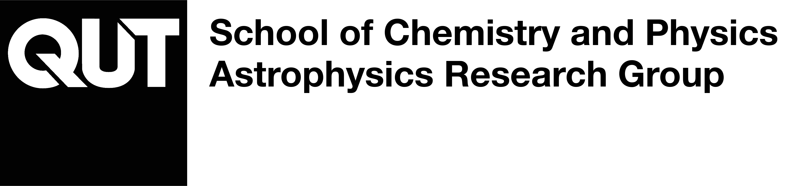

# AstroLabs



Astronomy practicals for **PVB210** and **PVB220 Cosmology** at QUT, developed by the QUT Astrophysics Research Group [(QARG)](https://research.qut.edu.au/qutastrophysics/).

* **AstroLabs C1 to C5 (PVB210)** use free astronomy software (SAOImageDS9, AstroImageJ and TOPCAT). Each lab has its own page with step-by-step instructions and the data to download.
* **AstroLabs C7 to C11 (PVB220)** are Python notebooks that run in Google Colab or QUT's JupyterHub with no installation.

The labs are designed for students across a university-wide minor, so **no programming experience is needed**. In the Python labs, every code cell is already written, and students run cells, change marked values and use sliders to explore real astronomical data. Students who want to learn Python can read and modify all of the code.

Companion repositories: [Astro_Demos](https://github.com/mjcowley/astro_demos) (interactive browser demos) and [Python_Intro](https://github.com/mjcowley/Python_Intro) (a general introduction to Python for physics).

## AstroLabs C1 to C5 (PVB210)

| Lab | Week | Topic | Software | Instructions |
| --- | :-: | --- | --- | --- |
| C1 | 2 | The celestial sphere and orbital mechanics (in development for 2027) | To be confirmed | [C1 page](C1/README.md) |
| C2 | 4 | Stellar spectra (in development for 2027) | To be confirmed | [C2 page](C2/README.md) |
| C3 | 6 | Composing RGB images from telescope data: JWST's view of the Carina Nebula, then your own choice of object at very different wavelengths | SAOImageDS9 | [C1 page](C1/README.md) |
| C4 | 8 | Studying stellar evolution with Gaia: querying the Gaia archive for the stars within 50 parsecs, building and cleaning an H–R diagram, and finding the Hyades cluster from its stars' motions to see how a cluster's H–R diagram reveals its age | TOPCAT | [C3 page](C3/README.md) |
| C5 | 10 | Hunting exoplanets: measuring the transit of WASP-2b with differential photometry, then comparing it with the same planet seen by NASA's TESS space telescope | AstroImageJ | [C2 page](C2/README.md) |

Each lab page links to its data files and the proforma. Proformas are submitted on Canvas.

## AstroLabs C7 to C11 (PVB220)

| Lab | Week | Topic | Notebook |
| --- | :-: | --- | --- |
| C7 | 2 | Your Python Toolkit for the Universe: distance scales, lookback time, the cosmological principle, Olbers' paradox and your first FITS image | [](https://colab.research.google.com/github/mjcowley/astrolabs/blob/main/C7/AstroLabC7.ipynb) |
| C8 | 4 | Running the Clock Backwards: Planck units, the scale factor and redshift, the CMB spectrum, the cosmic thermometer and JWST galaxy redshifts | [](https://colab.research.google.com/github/mjcowley/astrolabs/blob/main/C8/AstroLabC8.ipynb) |
| C9 | 6 | Galaxies and Their Monsters: the Hubble tuning fork, galaxy spectra and colours, the UVJ diagram, the quasar 3C 273 and its Eddington limit, broad and narrow lines, and X-ray AGN in the Chandra Deep Field South | [](https://colab.research.google.com/github/mjcowley/astrolabs/blob/main/C9/AstroLabC9.ipynb) |
| C10 | 8 | Gravity's Fingerprints: bending starlight and Einstein rings, dark matter in the rotation curve of NGC 2403, and finding, locating and weighing the gravitational wave GW150914 in real LIGO data | [](https://colab.research.google.com/github/mjcowley/astrolabs/blob/main/C10/AstroLabC10.ipynb) |
| C11 | 10 | Surveying the Universe: the Hubble constant and dark energy from Pantheon+ supernovae, the Hubble tension, galaxy scaling relations in ZFOURGE, and cross-matching with ZFIRE to test photometric redshifts, find a protocluster at z = 2.1 and diagnose galaxies with emission lines | [](https://colab.research.google.com/github/mjcowley/astrolabs/blob/main/C11/AstroLabC11.ipynb) |

## Session format

Each practical runs for two hours: a one-hour presentation on the science and the activity, then one hour of hands-on work supported by demonstrators. Practicals aren't submitted. Students complete multiple-choice **Canvas checkpoints** (marked 🎯 in the notebooks) as they work through each lab, and later choose one of labs C8 to C11 as the basis for their Sparkler poster presentation.

## How the notebooks work

Every notebook uses the same icons:

| Icon | Meaning |
| :-: | --- |
| ▶️ | Run this cell |
| 👉 | Change this value, then re-run the cell |
| 🎯 | Canvas checkpoint |
| 💡 | Hint |
| 🔍 | Peek inside: where to find the code behind a step |
| 🚀 | Stretch activity (optional) |

The first cell of each notebook downloads `astrolabs.py`, a small helper module holding the interactive widgets, data downloads and plot styling. The science steps (loading data, calculations and plots) stay visible in the notebook.

## Running the notebooks

**Google Colab (recommended):** click the *Open in Colab* badge above, then use **File > Save a copy in Drive** to keep your changes. Everything you need is already installed.

**QUT JupyterHub or a local install:** download the notebook from its lab folder (for example `C8/AstroLabC8.ipynb`) and open it. The first cell downloads `astrolabs.py` for you. For a local install, use Python 3.10 or later and install the requirements:

```bash
pip install -r requirements.txt
```

Data files are downloaded automatically into a `data/` folder the first time a notebook needs them.

## Structure

```
astrolabs/
├── C1/ ... C5/           # software labs: instructions, images and proforma
├── C7/ ... C11/          # Python labs: one notebook each (e.g. C7/AstroLabC7.ipynb)
├── astrolabs.py          # shared helper functions and widgets
├── canvas/               # HTML for each lab's Canvas page
├── data/C1/ ... data/C11/ # data files for each lab
├── docs/                 # maintainer guide
├── tools/                # notebook test script and data preparation scripts
├── Images/
└── requirements.txt
```

## Data credits

Each lab lists the sources and references for its data at the end. AstroLab C3 uses JWST NIRCam images of NGC 3324 from the JWST Early Release Observations (program 2731, MAST) and Spitzer and Herschel images of NGC 7293 from IRSA. AstroLab C4 uses Gaia DR3 (ESA, Gaia Collaboration, Vallenari et al. 2023). AstroLab C5 uses Faulkes Telescope North images of WASP-2 from the Las Cumbres Observatory archive and the TESS light curve of WASP-2 from MAST. AstroLab C7 uses the BATSE gamma-ray burst catalogue (NASA HEASARC), the 2MASS Redshift Survey (Huchra et al. 2012) and an image of NGC 1365 from the DESI Legacy Imaging Surveys DR10. AstroLab C8 uses the COBE FIRAS CMB spectrum (NASA LAMBDA), JWST NIRSpec spectra from JADES Data Release 4 (MAST), and CMB maps from Planck (NASA/IPAC IRSA) and WMAP (NASA LAMBDA). AstroLab C9 uses galaxy images from the DESI Legacy Imaging Surveys and SDSS, galaxy and AGN spectra from the Brown et al. (2014, 2019) atlases (MAST), the ZFOURGE survey (Straatman et al. 2016) with X-ray AGN matches from Cowley et al. (2016), and the Chandra Deep Field South 7 Ms catalogue (Luo et al. 2017). AstroLab C10 uses the SPARC rotation curve of NGC 2403 (Lelli et al. 2016) and LIGO, Virgo and KAGRA data and event catalogues from the Gravitational Wave Open Science Center. AstroLab C11 uses the Pantheon+ supernova compilation (Scolnic et al. 2022; Brout et al. 2022), the ZFOURGE COSMOS catalogue (Straatman et al. 2016) with UV + IR star formation rates (Tomczak et al. 2016) and HST sizes (van der Wel et al. 2014), and the ZFIRE COSMOS spectroscopic catalogue (Nanayakkara et al. 2016), all via VizieR or the Pantheon+ data release.

## Contributing

Contributions are welcome! If you have ideas for improvements or new labs, feel free to open an issue or submit a pull request.

If you're maintaining the labs or writing a new one, start with [docs/MAINTAINING.md](docs/MAINTAINING.md). It explains how the notebooks, `astrolabs.py` and the data fit together, how to make and test changes safely, and how to manage the repository.

## Acknowledgements

Special thanks to all contributors and to the open-source communities behind NumPy, pandas, Matplotlib, Astropy and Jupyter that make scientific computing and data visualisation possible.
